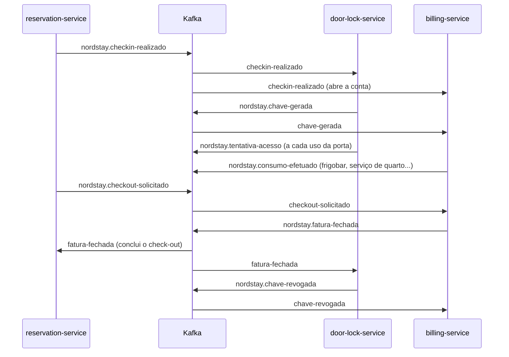

# Catálogo de eventos do NordStay

Contrato dos eventos trocados pelos serviços via Kafka.
Qualquer mudança aqui é uma mudança de contrato: abra PR e peça revisão de quem consome o evento.

> **Status:** proposta da NS-02. Os campos de `dados` são um ponto de partida e devem ser confirmados quando cada serviço implementar o seu evento.

---

## Visão geral

| Tópico | Produtor | Consumidores | Quando é publicado |
|---|---|---|---|
| `nordstay.checkin-realizado` | reservation-service | door-lock-service, billing-service | Hóspede fez check-in |
| `nordstay.chave-gerada` | door-lock-service | billing-service | Chave digital do quarto foi emitida |
| `nordstay.tentativa-acesso` | door-lock-service | auditoria | Alguém tentou abrir a porta (permitido ou negado) |
| `nordstay.consumo-efetuado` | billing-service | billing-service | Consumo lançado na conta do quarto |
| `nordstay.checkout-solicitado` | reservation-service | billing-service | Hóspede pediu check-out |
| `nordstay.chave-revogada` | door-lock-service | billing-service | Chave foi invalidada |
| `nordstay.fatura-fechada` | billing-service | reservation-service, door-lock-service | Conta do quarto foi fechada |

Cada tópico tem uma DLT `<tópico>.dlt` (ver [Erros e DLT](#erros-e-dlt)).

> **auditoria** ainda não é um serviço: por enquanto, o tópico só é retido (7 dias) para consulta.
> **consumo-efetuado → billing:** o billing publica e consome o próprio evento para registrar o lançamento de forma assíncrona e auditável. Se isso não se justificar, o evento pode virar uma operação interna.

### Fluxo principal



---

## Configuração dos tópicos

| Item | Tópico | DLT |
|---|---|---|
| Partições | 6 | 6 (mesmo número do tópico de origem) |
| Replication factor | 1 (ambiente local) | 1 |
| Retenção | 7 dias | 14 dias |
| `cleanup.policy` | `delete` | `delete` |
| Criação | `kafka-init` (lê `infra/kafka-init/topics.txt`) | idem, automática |

`auto.create.topics.enable=false` no broker: publicar num tópico que não está no catálogo falha.

---

## Convenções

### Chave da mensagem

**Chave = `quartoId`, em todos os tópicos.**
O Kafka manda mensagens com a mesma chave para a mesma partição, e a ordem só é garantida dentro de uma partição. Assim, todos os eventos de um quarto são processados na ordem em que aconteceram.

> Não altere o número de partições com o sistema em uso: a partição é `hash(chave) % partições`, e mudar esse número embaralha a ordem dos eventos em andamento.

### Envelope

Todo evento é um JSON com o mesmo envelope; o conteúdo específico vai em `dados`.

```json
{
  "id": "0f8c2a6e-5c1d-4d1b-9a3e-2b7f6c1d8e90",
  "tipo": "nordstay.checkin-realizado",
  "versao": 1,
  "ocorridoEm": "2026-11-10T17:30:00Z",
  "origem": "reservation-service",
  "correlacaoId": "res-2026-000123",
  "quartoId": "101",
  "dados": { }
}
```

| Campo | Tipo | Regra |
|---|---|---|
| `id` | UUID | Único por evento. Consumidores usam para **idempotência** (ignorar repetidos). |
| `tipo` | string | Igual ao nome do tópico. |
| `versao` | inteiro | Versão do formato de `dados` (ver [Versionamento](#versionamento)). |
| `ocorridoEm` | ISO-8601, UTC | Quando o fato aconteceu, não quando foi publicado. |
| `origem` | string | Serviço que publicou. |
| `correlacaoId` | string | Liga todos os eventos de uma mesma estadia (o `reservaId`). |
| `quartoId` | string | Igual à chave da mensagem. |
| `dados` | objeto | Conteúdo específico do evento. |

### Tipos de dados

- **Datas e horas:** ISO-8601 em UTC (`2026-11-10T17:30:00Z`). Conversão para fuso local só na tela.
- **Dinheiro:** inteiro em **centavos** + moeda (`{"centavos": 4590, "moeda": "BRL"}`). Nunca `double`.
- **Enums:** strings em MAIÚSCULAS (`PERMITIDO`, `NEGADO`).
- **Dados pessoais (LGPD):** só identificadores (`hospedeId`). Nome, documento, e-mail e telefone **não** trafegam nos eventos.
- **Segredos:** nenhum evento carrega o código ou token da chave digital.

### Versionamento

Sem Schema Registry: a versão vai no campo `versao`.

- **Mudança compatível** (novo campo opcional): mantém a versão. Consumidores ignoram campos que não conhecem.
- **Mudança incompatível** (remover, renomear ou mudar o tipo de um campo): incrementa `versao`. O produtor publica a versão nova e os consumidores aceitam as duas até todos migrarem.
- Registre cada mudança na seção [Histórico](#histórico) deste arquivo.

---

## Eventos

### `nordstay.checkin-realizado` · v1

**Produtor:** reservation-service · **Consumidores:** door-lock-service (gera a chave), billing-service (abre a conta)

```json
{
  "id": "0f8c2a6e-5c1d-4d1b-9a3e-2b7f6c1d8e90",
  "tipo": "nordstay.checkin-realizado",
  "versao": 1,
  "ocorridoEm": "2026-11-10T17:30:00Z",
  "origem": "reservation-service",
  "correlacaoId": "res-2026-000123",
  "quartoId": "101",
  "dados": {
    "reservaId": "res-2026-000123",
    "hospedeId": "hsp-000045",
    "tipoQuarto": "SUITE_MASTER",
    "numeroHospedes": 2,
    "checkinEm": "2026-11-10T17:30:00Z",
    "checkoutPrevisto": "2026-11-13T15:00:00Z"
  }
}
```

### `nordstay.chave-gerada` · v1

**Produtor:** door-lock-service · **Consumidor:** billing-service

```json
{
  "tipo": "nordstay.chave-gerada",
  "versao": 1,
  "quartoId": "101",
  "dados": {
    "chaveId": "chv-9a7c",
    "reservaId": "res-2026-000123",
    "validaDe": "2026-11-10T17:30:00Z",
    "validaAte": "2026-11-13T15:00:00Z"
  }
}
```

> O código da chave **não** vai no evento.

### `nordstay.tentativa-acesso` · v1

**Produtor:** door-lock-service · **Consumidor:** auditoria

```json
{
  "tipo": "nordstay.tentativa-acesso",
  "versao": 1,
  "quartoId": "101",
  "dados": {
    "chaveId": "chv-9a7c",
    "resultado": "NEGADO",
    "motivo": "CHAVE_EXPIRADA",
    "tentativaEm": "2026-11-13T16:02:11Z"
  }
}
```

`resultado`: `PERMITIDO` · `NEGADO`
`motivo` (quando `NEGADO`): `CHAVE_EXPIRADA` · `CHAVE_REVOGADA` · `CHAVE_INVALIDA` · `QUARTO_ERRADO`

### `nordstay.consumo-efetuado` · v1

**Produtor:** billing-service · **Consumidor:** billing-service

```json
{
  "tipo": "nordstay.consumo-efetuado",
  "versao": 1,
  "quartoId": "101",
  "dados": {
    "consumoId": "cns-00078",
    "reservaId": "res-2026-000123",
    "categoria": "FRIGOBAR",
    "descricao": "Água mineral 500 ml",
    "quantidade": 2,
    "valorUnitario": { "centavos": 800, "moeda": "BRL" },
    "lancadoEm": "2026-11-11T22:15:00Z"
  }
}
```

`categoria`: `FRIGOBAR` · `SERVICO_DE_QUARTO` · `LAVANDERIA` · `OUTROS`

### `nordstay.checkout-solicitado` · v1

**Produtor:** reservation-service · **Consumidor:** billing-service

```json
{
  "tipo": "nordstay.checkout-solicitado",
  "versao": 1,
  "quartoId": "101",
  "dados": {
    "reservaId": "res-2026-000123",
    "canal": "RECEPCAO",
    "solicitadoEm": "2026-11-13T11:40:00Z"
  }
}
```

`canal`: `RECEPCAO` · `APP`

### `nordstay.chave-revogada` · v1

**Produtor:** door-lock-service · **Consumidor:** billing-service

```json
{
  "tipo": "nordstay.chave-revogada",
  "versao": 1,
  "quartoId": "101",
  "dados": {
    "chaveId": "chv-9a7c",
    "reservaId": "res-2026-000123",
    "motivo": "CHECKOUT",
    "revogadaEm": "2026-11-13T11:45:30Z"
  }
}
```

`motivo`: `CHECKOUT` · `PERDA` · `SEGURANCA`

### `nordstay.fatura-fechada` · v1

**Produtor:** billing-service · **Consumidores:** reservation-service (conclui o check-out), door-lock-service (revoga a chave)

```json
{
  "tipo": "nordstay.fatura-fechada",
  "versao": 1,
  "quartoId": "101",
  "dados": {
    "faturaId": "fat-2026-000311",
    "reservaId": "res-2026-000123",
    "total": { "centavos": 187600, "moeda": "BRL" },
    "status": "PAGA",
    "fechadaEm": "2026-11-13T11:45:00Z"
  }
}
```

`status`: `PAGA` · `PENDENTE`

> Nos exemplos a partir de `chave-gerada`, os campos `id`, `ocorridoEm`, `origem` e `correlacaoId` do envelope foram omitidos para encurtar; eles são obrigatórios em todos os eventos.

---

## Erros e DLT

| Situação | Retentativas | Destino |
|---|---|---|
| Erro de **deserialização** (JSON inválido, versão desconhecida) | nenhuma | DLT imediatamente |
| Erro de negócio **transitório** (banco ou serviço indisponível) | 3, com backoff de 1 s, 2 s e 4 s | DLT após a 3ª falha |
| Erro de negócio **permanente** (ex.: reserva inexistente) | nenhuma | DLT imediatamente |

A mensagem vai para a DLT **na mesma partição** de origem, com o payload original intacto e headers com o motivo da falha. Com Spring Kafka (`DeadLetterPublishingRecoverer`):

| Header | Conteúdo |
|---|---|
| `kafka_dlt-exception-fqcn` | Classe da exceção |
| `kafka_dlt-exception-message` | Mensagem do erro |
| `kafka_dlt-exception-stacktrace` | Stack trace |
| `kafka_dlt-original-topic` | Tópico de origem |
| `kafka_dlt-original-partition` | Partição de origem |
| `kafka_dlt-original-offset` | Offset de origem |
| `kafka_dlt-original-timestamp` | Timestamp original |

> **Pendente (depende da NS-00):** definir se o tratamento de erro usa **Spring Kafka** (`DefaultErrorHandler` + `DeadLetterPublishingRecoverer`) ou o binder do **Spring Cloud Stream** (`enableDlq`, `maxAttempts`, `backOff*`). Os headers acima são os do Spring Kafka.

**Reprocessar uma DLT:** corrigir a causa e republicar a mensagem no tópico de origem, mantendo o mesmo `id`, para que os consumidores idempotentes não dupliquem o efeito.

---

## Como inspecionar

```powershell
cd infra

# listar tópicos e DLTs
docker compose exec kafka /opt/kafka/bin/kafka-topics.sh --bootstrap-server kafka:29092 --list --exclude-internal

# ler um tópico mostrando chave e partição
docker compose exec kafka /opt/kafka/bin/kafka-console-consumer.sh `
  --bootstrap-server kafka:29092 --topic nordstay.checkin-realizado --from-beginning `
  --property print.key=true --property print.partition=true --timeout-ms 10000

# ler uma DLT com os headers de erro
docker compose exec kafka /opt/kafka/bin/kafka-console-consumer.sh `
  --bootstrap-server kafka:29092 --topic nordstay.checkin-realizado.dlt --from-beginning `
  --property print.headers=true --timeout-ms 10000
```

---

## Histórico

| Data | Evento | Versão | Mudança |
|---|---|---|---|
| 2026-11-10 | todos | 1 | Catálogo inicial (NS-02) |